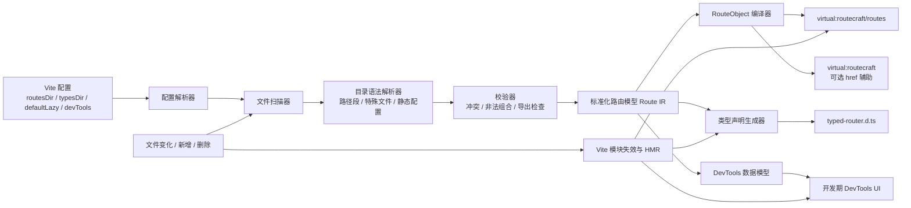
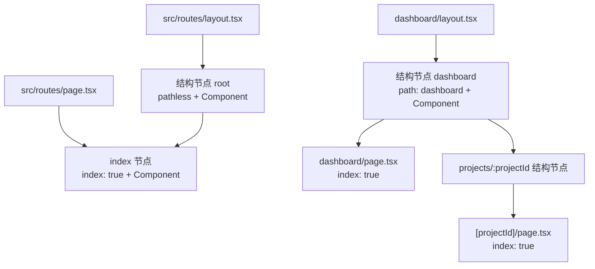

# Routecraft — Vite + React Router 文件路由插件设计方案

| 项目 | 内容 |
| --- | --- |
| 项目设计名称 | **Routecraft** |
| 产品形态 | 使用 TypeScript 编写的 Vite 插件，以及配套的轻量运行时接口和开发者工具 |
| 设计日期 | 2026-11-12 |
| 适用项目 | 使用 Vite 构建、使用 React Router Data Mode 管理路由的 React 应用 |
| 核心方案 | 自建目录扫描器与路由编译器，借鉴 Next.js App Router 的目录表达方式，输出 React Router 数据路由对象 |
| API 参考基线 | React Router **v8.5.1（2026-10-27）** 官方变更记录；设计查阅日期为 2026-11-12 |
| 文档性质 | 产品功能与技术架构设计；不是实施排期，不表示插件已经发布 |

## 1. 项目定义

### 1.1 一句话定位

**Routecraft 把约定目录中的页面、布局和数据处理模块，编译成应用可以直接交给 React Router 的数据路由表，同时生成类型声明并提供可视化路由检查工具。**

Routecraft 不是一个新的路由器，不替代 React Router，也不把 Next.js 的服务端框架能力移植到普通 Vite 应用。它负责解决三件事：

1. **目录成为路由配置的来源**：开发者维护页面目录，不再手工同步大型嵌套路由对象。
2. **路由信息成为可检查的类型契约**：路径、参数、路由标识及数据类型来自同一份编译结果。
3. **生成过程可以被解释**：DevTools 能回答“这个 URL 来自哪个目录”“为什么使用 lazy”“loader 属于哪条路由”“冲突发生在哪里”。

### 1.2 项目命名与交付物

文档统一使用 **Routecraft** 作为项目设计名称。建议的 npm 包名为 `vite-plugin-react-router-routecraft`；该名称仅用于阐明接口，未声称已注册或可用。Vite 官方建议框架专用插件名带上对应框架标识，因此包名显式包含 React Router。[Vite 插件命名约定](https://vite.dev/guide/api-plugin#conventions)

| 交付物 | 职责 | 使用者 |
| --- | --- | --- |
| Vite 插件入口 | 读取配置、扫描目录、编译路由、监听变化、提供开发工具服务 | `vite.config.ts` |
| 虚拟路由模块 | 向应用提供编译后的 `routeObjects` | 应用路由入口 |
| 运行时辅助入口 | 提供类型化路径构造等少量辅助能力 | 页面和导航组件 |
| `typed-router.d.ts` | 声明虚拟模块，提供路由路径、参数和标识类型 | TypeScript |
| DevTools UI | 展示路由树、模块映射、加载方式和诊断 | 开发者 |

上述入口是同一产品的不同接口，不代表需要拆成多个独立 npm 包。

### 1.3 设计原则

- **先定义语义，再生成代码**：目录、路由模块与 React Router 对象之间必须有确定映射。
- **一个来源，多种产物**：路由模块、类型声明和 DevTools 使用同一份标准化路由模型。
- **可选能力保持可选**：没有 `loader` 就不生成 `loader`；不同模块可以选择不同加载方式。
- **框架事实与插件约定分开**：官方能力注明来源，Routecraft 自定义规则明确标识。
- **不伪造等价能力**：不能从 Data Router 得到的 Next.js 行为，不通过相似文件名暗示已实现。

## 2. 核心功能与开发者工作流

### 2.1 核心功能

| 功能 | 开发者输入 | Routecraft 输出 |
| --- | --- | --- |
| 目录路由编译 | 指定路由根目录及约定文件 | 嵌套数据路由对象 |
| 布局与页面组合 | `layout.tsx`、`page.tsx` | 结构路由与索引路由 |
| 按模块控制加载方式 | 显式静态配置与项目默认值 | 静态导入或动态导入 |
| 可选数据处理 | 按需导出的 `loader`、`action` | 对应路由字段；未导出则省略 |
| 路由类型生成 | 标准化路由模型与模块类型 | `typed-router.d.ts` |
| 规则诊断 | 重复 URL、非法目录、无效导出等 | 定位到文件的错误说明 |
| 可视化检查 | 编译结果与开发期诊断 | 可选 DevTools UI |

### 2.2 正常使用过程

```text
在 Vite 配置中启用插件
          ↓
在指定根目录创建页面、布局与可选数据模块
          ↓
插件扫描并校验，生成路由模块与声明文件
          ↓
应用导入路由表，交给 createBrowserRouter
          ↓
React Router 负责匹配、导航、数据调用与页面渲染
          ↓
开发者可在 DevTools 检查编译后的路由关系
```

**职责界线：Routecraft 生成配置，React Router 执行路由，Vite 处理模块构建，应用负责业务行为。**

## 3. 插件接入方式与虚拟模块

### 3.1 Vite 配置

```ts
// vite.config.ts
import { defineConfig } from "vite";
import react from "@vitejs/plugin-react";
import routecraft from "vite-plugin-react-router-routecraft";

export default defineConfig({
  plugins: [
    react(),
    routecraft({
      routesDir: "src/routes",
      typesDir: "src/types",
      defaultLazy: true,
      devTools: true,
    }),
  ],
});
```

配置字段定义：

| 字段 | 类型 | 默认值 | 语义 |
| --- | --- | --- | --- |
| `routesDir` | `string` | `"src/routes"` | 相对于 Vite 项目根目录的扫描根目录 |
| `typesDir` | `string` | `"src/types"` | 相对于 Vite 项目根目录的声明文件输出目录 |
| `defaultLazy` | `boolean` | `true` | 路由实现模块未单独配置时，是否使用动态导入 |
| `devTools` | `boolean` | `false` | 是否在开发服务器中启用 Routecraft DevTools 页面与诊断接口 |

插件只在 Vite 项目中启用。两个路径在 Vite 配置解析后按项目根目录归一化。`routesDir` 必须存在且可读；`typesDir` 不存在时由插件创建，无法创建或不可写时给出带配置字段名的诊断。插件不得把输出目录自动改写成扫描根目录，也不得静默回退到其他目录。

### 3.2 运行环境与版本前提

本设计以 React Router 官方变更记录中截至 **2026-11-12 的最新稳定版 v8.5.1（2026-10-27）** 为 API 参考基线。React Router v8 的 Node.js/React 最低版本分别为 22.22.0+、19.2.7+，并改为 ESM-only；官方 `@react-router/dev` Framework Mode 工具要求 Vite 7+。本方案是自建 Vite 插件并采用 Data Mode，**不把 `@react-router/dev` 的 peer 约束误写成 Data Mode 的框架前提**；Routecraft 自身选择 Vite 7+ 作为兼容支持基线，并将 `vite`、`react-router`、`react` 声明为 peer dependencies。插件在 Node 侧使用 TypeScript 编译器 API 解析静态配置和导出，不执行用户模块；`typescript` 是插件运行期依赖，但不会进入浏览器运行时包。发布时仍须按目标 Vite/React Router 版本组合做兼容性测试。[React Router v8 变更记录](https://reactrouter.com/changelog)

### 3.3 应用入口

```ts
// src/router.ts：由虚拟模块提供 routeObjects
import { createBrowserRouter } from "react-router";
import { routeObjects } from "virtual:routecraft/routes";

export const router = createBrowserRouter(routeObjects);
```

```tsx
// src/main.tsx：由应用按 React Router Data Mode 方式挂载
import { createRoot } from "react-dom/client";
import { RouterProvider } from "react-router/dom";
import { router } from "./router";

createRoot(document.getElementById("root")!).render(
  <RouterProvider router={router} />,
);
```

`virtual:routecraft/routes` 是 **Routecraft 定义、由 Vite 插件解析的虚拟模块标识符**，不是 React Router 自带的包或 API。应用导入它时，Vite 插件的 `resolveId` 将公开标识符解析到内部虚拟 ID，`load` 再返回编译器生成的模块源码。Vite 官方把虚拟模块定义为可通过普通 ESM `import` 使用的构建期模块，并给出了 `resolveId`/`load` 的实现约定。[Vite 插件 API：Importing a Virtual File](https://vite.dev/guide/api-plugin#virtual-modules-convention)

可以把这段 import 理解为“在应用源码中引用一个由插件即时提供的模块”：

```text
应用源码中的 import
  "virtual:routecraft/routes"
             │
             ▼
Routecraft.resolveId()
             │
             ▼
Routecraft.load() ──► 编译器生成的 routeObjects 模块源码
```

Vite 对应用公开的标识符使用 `virtual:` 前缀；插件内部将它解析为带 `\0` 前缀的虚拟 ID，再提供模块源码。`\0` 是插件模块图中的内部标记，不写在应用的 `import` 语句里。

选择虚拟模块的原因是：路由表由 Vite 插件管理，不需要把可执行路由模块作为生成文件写进源代码目录；开发时插件可在目录变化后重新编译并让 Vite 的模块图失效/更新。与之不同，TypeScript 声明文件必须以真实 `.d.ts` 文件形式写入项目，供 TypeScript 语言服务和构建读取。**因此 Routecraft 的设计是“运行时路由表走虚拟模块，静态类型信息走真实声明文件”。**

### 3.4 可选运行时类型辅助

除路由对象外，插件提供一个小型虚拟辅助模块，避免把路径参数插值逻辑散落在应用中：

```ts
import { href } from "virtual:routecraft";

const path = href("/dashboard/projects/:projectId", {
  projectId: "p-42",
});
```

`href` 仅负责依据生成的路由路径类型检查参数，并通过 React Router `generatePath` 构造 URL；最终仍交给 React Router 的 `<Link>`、`navigate` 等 API 完成导航。它不会替换这些 API，也不会改变 React Router 的路径匹配规则。插件为此额外解析 `virtual:routecraft`，并从真实生成的 `typed-router.d.ts` 提供其类型声明。该辅助入口是可选产品接口；不需要类型化 URL 构造时，应用只使用 `virtual:routecraft/routes` 即可。

## 4. 核心架构

### 4.1 组件职责



### 4.2 模块边界

| 子系统 | 输入 | 输出 | 责任边界 |
| --- | --- | --- | --- |
| 配置解析器 | Vite resolved config、插件选项 | 归一化配置 | 统一项目根目录和路由/声明输出绝对路径 |
| 文件扫描器 | `routesDir`、文件系统 | 有序文件快照 | 识别目录和文件；不推断 React Router 语义 |
| 语法解析器 | 文件快照、静态路由配置 | 路由节点和模块引用 | 把目录语法解释为路径段、布局、页面和数据模块 |
| 导出分析器 | `.ts`/`.tsx` 路由模块 | 导出元数据 | 使用 TypeScript AST，不执行应用模块；检查默认导出、命名导出及静态配置语法 |
| 校验器 | 标准化前路由树 | 诊断列表 | 报告重复路径、非法段、悬空模块、命名冲突及无效组合 |
| 标准化路由模型 | 已解析且通过校验的路由树 | `Route IR` | 作为路由对象、类型和 DevTools 的唯一数据源 |
| RouteObject 编译器 | `Route IR` | 虚拟模块源码 | 将模块引用、加载方式、路由层级编译成 `RouteObject[]` |
| 类型声明生成器 | `Route IR` | `typed-router.d.ts` | 生成路径、路由 ID、参数及虚拟模块的 TypeScript 声明 |
| DevTools 服务/UI | `Route IR`、诊断、Vite dev server | 浏览器页面和更新事件 | 只在开发期展示，不参与生产路由运行时 |
| Vite 适配层 | Vite 插件生命周期 | resolve/load/watch/HMR 接口 | 通过 `resolveId`/`load` 提供路由表与可选辅助虚拟模块，通过 dev-server watcher 接入路由目录变化，并连接 Vite 生命周期与纯逻辑模块 |

`Route IR` 至少包含：稳定路由 ID、目录来源、父子关系、React Router 路径表达式、页面/布局/错误边界模块引用、loader/action 模块引用、每个模块的 eager/lazy 状态、计算后的公开路径及诊断关联信息。它不是 React Router `RouteObject` 的简单副本，而是保留“源文件来自哪里、为何如此编译”等生成与诊断所需元数据的中间表示。

### 4.3 编译流程与失败策略

1. 插件读取 resolved Vite 配置并归一化两个目录选项。
2. 扫描器产生稳定排序的文件快照；排序规则固定为路径字典序，避免生成结果随操作系统遍历顺序变化。
3. 解析器识别路由目录语法和 Routecraft 特殊文件；普通组件、样式、测试等 colocated 文件不自动成为路由。
4. 导出分析器通过 TypeScript AST 读取路由模块的导出形态，不执行模块，不触发业务副作用。
5. 校验器在编译前汇总错误。配置无效、路径冲突或必需导出缺失时，开发服务器报出可定位诊断，生产构建失败；不生成一棵“看似成功但语义错误”的部分路由树。
6. 通过校验后生成一份 `Route IR`，再由三个独立 consumer 生成虚拟路由模块、声明文件、DevTools 数据。
7. 开发期插件将 `routesDir` 加入 Vite dev server watcher，覆盖新增、删除和修改事件；变化后重新扫描、校验和编译。若结果改变，失效虚拟模块、原子更新声明文件，并推送 DevTools 更新。生成的 `typed-router.d.ts` 不作为路由输入；如果输出目录位于路由根目录中，扫描器仍明确忽略该生成文件，避免自触发循环。若发生语法/路径错误，保留最新错误诊断，不把旧路由树伪装成新结果。

**关键架构约束：**类型生成器和 DevTools 不各自重新解释目录规则；它们只读取同一份 `Route IR`，从而避免“浏览器运行的路由”和“编辑器看到的类型/树”不一致。

## 5. Next.js App Router 规则解析

Routecraft 参考的是 Next.js App Router 的**目录组织和路由表达能力**，而不是其整个运行时。Next.js App Router 把目录映射为 URL 段，目录嵌套形成嵌套路由；某个 segment 直接包含 `page` 或 `route` 时，该 segment 才有对应的页面或 HTTP 入口，祖先目录则为后代路由提供路径段和布局层级。`page`、`layout`、路由组、私有目录、动态段以及 loading/error/not-found 等文件各有框架定义的含义。[Next.js 项目结构](https://nextjs.org/docs/app/getting-started/project-structure)

### 5.1 App Router 的路由骨架

Next.js 的一个常见 App Router 树形结构如下：

```text
app/
├── layout.tsx                 # 常见根布局；使用多个 root layout 时可由 route group 分别提供
├── page.tsx                   # /
├── dashboard/
│   ├── layout.tsx             # /dashboard 子树共享布局
│   ├── page.tsx               # /dashboard
│   └── projects/
│       └── [projectId]/
│           └── page.tsx       # /dashboard/projects/:projectId
└── (marketing)/
    └── about/
        └── page.tsx           # /about；marketing 不进入 URL
```

`page` 创建具体可访问页面；`layout` 按目录层级包裹该路由及其后代，导航时可保留布局状态。Next.js 的常规单根布局负责输出 `<html>` 和 `<body>`，也允许借助不同 Route Group 建立多个根布局。Vite + React Router Data Mode 没有这套框架级文档壳生命周期，因此 Routecraft 的 `layout.tsx` 是普通路由组件，必须通过 `<Outlet />` 渲染子路由；应用的 HTML 文档仍由 Vite 的 `index.html` 和 React 挂载入口负责，不能把 Next 根布局契约照搬过来。[Next.js 布局与页面](https://nextjs.org/docs/app/getting-started/layouts-and-pages)；[Next.js 项目结构](https://nextjs.org/docs/app/getting-started/project-structure)

### 5.2 路由分组和私有目录

| Next.js 约定 | Next.js 中的含义 | 对 URL 的影响 |
| --- | --- | --- |
| `(marketing)` | 只用于组织路由、按组放置布局等 | 该目录名不进入 URL |
| `_components` | 私有目录及其子树不参与路由 | 不生成 URL 段 |
| 普通目录 `dashboard` | 一个 URL segment | 进入 URL |

不同 Route Group 下如果最终解析到相同 URL，组名不同并不能区分 URL，因而会造成路由冲突。私有目录适合放置实现文件；Next.js 也允许未命中特殊路由文件名的普通文件与路由文件共置，所以私有目录是明确排除一整棵子树的组织手段，不是所有非路由代码的必要位置。[Next.js 项目结构与路由组](https://nextjs.org/docs/app/getting-started/project-structure)

### 5.3 动态路由段

Next.js 的动态段使用方括号：

| Next.js 目录名 | Next.js 参数语义 | 例子 |
| --- | --- | --- |
| `[slug]` | 单个动态段，参数是字符串 | `/blog/[slug]` → `/blog/hello` |
| `[...slug]` | 必需 catch-all；可匹配多个后续段，参数是字符串数组 | `/shop/[...slug]` → `/shop/a/b` |
| `[[...slug]]` | 可选 catch-all；基路径本身也匹配，参数可缺省 | `/shop/[[...slug]]` → `/shop` 或 `/shop/a` |

Next.js 还提供 `PageProps`、`LayoutProps`、`RouteContext` 等路由相关类型。当前文档中的 `params` 是异步 Promise；单段值为字符串，catch-all 为字符串数组，可选 catch-all 缺省时为 `undefined`。这些 Next.js 参数 props 和类型契约均不等于 React Router Data Mode 中由 `useParams` 或 loader 参数取得的形状。[Next.js 动态路由段](https://nextjs.org/docs/app/api-reference/file-conventions/dynamic-routes)

### 5.4 特殊文件及其运行时语义

| Next.js 文件/机制 | 官方语义摘要 | 是否只是“一个 React 组件” |
| --- | --- | --- |
| `page.tsx` | 具体页面入口；是其路由匹配树中的叶端 UI，默认是 Server Component（可显式设为 Client Component），接收框架定义的 `params`、`searchParams` 等 | 否，绑定 Next.js 渲染与参数契约 |
| `layout.tsx` | 持久化的嵌套布局，接收 `children`；根布局负责文档级结构；同级子页面导航时布局可复用 | 否，含框架生命周期与 props 约定 |
| `template.tsx` | 类似 layout，但按路由段变化重新挂载，重置子组件状态并重新同步 effect | 否，生命周期语义不同于 layout |
| `loading.tsx` | 自动建立 Suspense 边界并在服务端流式渲染期间展示 fallback | 否，不等同于 Data Mode 的任意路由属性 |
| `error.tsx` | 自动包裹对应路由段及其后代；必须是 Client Component。当前文件约定文档列出 `error`、`retry`，并保留 `reset` 作为不重新获取数据的替代方案；Next.js 16.2 曾使用 `unstable_retry` 名称，16.3 起 `retry` 稳定 | 否，props 与边界层级由 Next 控制；同段 layout 的错误需由更上层边界处理 |
| `not-found.tsx` | 配合 `notFound()` 控制流显示段级 not-found UI；另有全局 not-found 机制 | 否，不只是 URL 中的 `*` 页面 |
| `route.ts` | Web Request/Response API 的 HTTP Route Handler，支持 HTTP 方法；不能与同一路径层级的 `page.tsx` 并存 | 否，是服务端 HTTP 入口而非 UI 路由模块 |
| `default.tsx` | Parallel Route slot 的 fallback，用于无法恢复 slot 状态时渲染 | 否，依赖 Parallel Routes 状态 |
| `@slot` | Parallel Routes 的命名槽位；作为 props 传给布局，不增加 URL 段 | 否，需要布局接收并并行渲染多个 slot |
| `(.)`、`(..)` 等 | Intercepting Routes，用于软导航与直接访问呈现不同层级/上下文 | 否，依赖导航方式和被拦截路由语义 |
| metadata 文件与 `generateMetadata` | 生成页面 metadata/OG 元数据，受 Next 服务端渲染生命周期管理 | 否，不是普通路由对象组件 |
| route segment config、`proxy` 等 | 控制 Next.js 的渲染、缓存、运行时或请求处理行为 | 否，依赖 Next.js 服务端运行时 |

上述行为依据 Next.js 当前 App Router 关于[项目结构](https://nextjs.org/docs/app/getting-started/project-structure)、[页面](https://nextjs.org/docs/app/api-reference/file-conventions/page)、[布局](https://nextjs.org/docs/app/api-reference/file-conventions/layout)、[动态路由](https://nextjs.org/docs/app/api-reference/file-conventions/dynamic-routes)、[loading](https://nextjs.org/docs/app/api-reference/file-conventions/loading)、[error](https://nextjs.org/docs/app/api-reference/file-conventions/error)、[not-found](https://nextjs.org/docs/app/api-reference/file-conventions/not-found)、[template](https://nextjs.org/docs/app/api-reference/file-conventions/template)、[Parallel Routes](https://nextjs.org/docs/app/api-reference/file-conventions/parallel-routes)、[Intercepting Routes](https://nextjs.org/docs/app/api-reference/file-conventions/intercepting-routes) 与 [Route Handler](https://nextjs.org/docs/app/api-reference/file-conventions/route) 的官方文档。例如 `loading.tsx` 自动建立加载边界；`route.ts` 定义 HTTP 请求处理器；`@slot` 不进入 URL，但需要父布局接收并渲染对应 slot。

## 6. Routecraft 对 Next.js 规则的取舍

| Next.js 规则/能力 | Routecraft 决定 | 理由及 React Router 对应关系 |
| --- | --- | --- |
| 文件夹对应 URL 段 | **采用** | 与路由目录扫描直接匹配 |
| `page.tsx` | **采用名称和“页面入口”概念，重新定义运行契约** | 生成 React Router index route；组件使用 Data Mode，不接收 Next.js `params` props |
| `layout.tsx` | **采用名称和嵌套布局位置，重新定义渲染契约** | 映射到承载同级 segment 的父 RouteObject；组件必须渲染 `<Outlet />`，不是接收 `children` |
| `(group)` 路由组 | **采用** | 编译为 pathless route；保留独立布局层级，不生成 URL 段 |
| `_private` 私有目录 | **采用** | 整个子树排除扫描，明确表示不参与路由 |
| `[param]` 动态段 | **采用并转写语法** | 映射为 React Router `:param`；由 `useParams`/loader args 获取 |
| `[...param]` catch-all | **有限采用，语义重新定义** | 映射到 React Router splat `*`；读取 `params["*"]` 字符串，并接受 React Router 的空尾段匹配；不声称等价于 Next 的非空数组参数 |
| `[[...param]]` 可选 catch-all | **不提供** | 同样映射为 `*` 会与上述规则产生相同匹配模式，无法同时保留 Next 对必需/可选 catch-all 的差异；不通过运行时包装伪造 |
| `error.tsx` | **采用文件名，映射到 React Router Error Boundary** | 使用 React Router 的 `ErrorBoundary`/`useRouteError` 契约；不提供 Next 文件约定中的 `retry`、`reset` 或历史版本的 `unstable_retry` props |
| 根 `not-found.tsx` | **有限采用** | 只映射为根层 `path: "*"` unmatched route 以显示兜底 UI；不实现 Next `notFound()` 的段级控制流，也不自动设置 SPA HTTP 404 状态 |
| `loading.tsx` | **不映射** | React Router Data Mode 的 pending navigation / lazy route 状态需由应用使用 `useNavigation`、Suspense 或自定义 UI 决定；这不等同于 Next 自动加边界 |
| `template.tsx` | **不映射** | Data Router 没有与 Next 自动 remount-key 生命周期相同的文件约定 |
| `route.ts` HTTP Handler | **不识别为路由文件** | 插件产物是客户端/应用侧数据路由对象，不是 Vite 服务端 API 路由系统 |
| Parallel / Intercepting Routes | **不映射** | Data RouteObject 的嵌套树没有 Next slots 和软导航拦截状态的等价文件语义 |
| Next Metadata API、Server Components、缓存、流式服务端渲染配置 | **不映射** | 依赖 Next.js 服务端框架契约，不属于 Vite + React Router Data Mode 路由表编译 |

**取舍原则：**如果 React Router 的 RouteObject 可以表达同一类路由结构，就编译为其原生字段；若能力依赖 Next.js 的渲染/服务端控制流，Routecraft 就不以文件名或生成代码伪装成兼容实现。

**页面树语义差异：**Next.js 的 `page` 是其匹配树中的叶端 UI；Routecraft 允许一个目录同时包含 `page.tsx` 和子目录，是因为它把 `page.tsx` 编译为该目录结构路由下的 index child，而子目录作为兄弟 child route。这样遵循 React Router 对 index route 不承载子路由的约束，同时让目录路径可以有索引页和更深层页面。

## 7. Routecraft 目录与模块规范

### 7.1 标准目录结构

```text
src/routes/
├── layout.tsx                    # 可选根布局；React Router pathless 根路由
├── page.tsx                      # 可选根 index 页面，对应 /
├── middleware.ts                 # 可选全局 middleware，挂到共同合成根
├── hydrate-fallback.tsx          # 可选初始 hydration fallback
├── error.tsx                     # 可选根错误边界
├── not-found.tsx                 # 可选根级未匹配兜底，编译为 path: "*"
├── loader.ts                     # 可选：本目录 page.tsx 的 loader
├── action.ts                     # 可选：本目录 page.tsx 的 action
├── route.config.ts               # 可选：本目录路由模块的静态配置
├── (public)/                     # 路由组：pathless，不进入 URL
│   ├── layout.tsx                # 该组的布局
│   └── about/
│       └── page.tsx              # /about
├── dashboard/
│   ├── layout.tsx                # /dashboard 子树布局
│   ├── layout.loader.ts          # 可选：layout route 的 loader
│   ├── page.tsx                  # /dashboard（index route）
│   ├── loader.ts                 # 只属于 /dashboard 的 index 页面
│   ├── action.ts                 # 只属于 /dashboard 的 index 页面
│   ├── error.tsx                 # /dashboard 段错误边界
│   ├── route.config.ts
│   └── projects/
│       └── [projectId]/
│           ├── page.tsx          # /dashboard/projects/:projectId
│           ├── loader.ts
│           └── action.ts
└── _components/                  # 整棵子树忽略
    └── ProjectCard.tsx
```

### 多根分支与不同布局的完整示例

下面的组织方式可表达“根页面、认证页面布局、工作区布局”三条分支。括号目录是 pathless route group，所以它们不会进入 URL；`auth/` 与 `workspace/` 是实际 URL 段。

```text
src/routes/
├── middleware.ts                 # 可选：共同合成根的 middleware，影响所有分支
├── page.tsx                       # /
├── (auth)/
│   └── auth/
│       ├── layout.tsx             # /auth 的 BlankLayout
│       ├── sign-in/
│       │   └── page.tsx           # /auth/sign-in
│       └── sign-up/
│           └── page.tsx           # /auth/sign-up
└── (workspace)/
    └── workspace/
        ├── layout.tsx             # /workspace 的 BasicLayout
        ├── page.tsx               # /workspace（index route）
        └── projects/
            └── [projectId]/
                └── page.tsx       # /workspace/projects/:projectId
```

该目录树编译为以下 RouteObject 层级（只展示结构字段；页面与布局的 `Component`、`loader` 等由各自模块加载策略补入）：

```text
共同合成根（middleware.ts 可在此处）
├── page.tsx                                      index: true → /
├── (auth)                                        pathless
│   └── auth                                      path: "auth", Component: BlankLayout
│       ├── sign-in                               path: "sign-in"
│       │   └── page.tsx                          index: true → /auth/sign-in
│       └── sign-up                               path: "sign-up"
│           └── page.tsx                          index: true → /auth/sign-up
└── (workspace)                                   pathless
    └── workspace                                 path: "workspace", Component: BasicLayout
        ├── page.tsx                              index: true → /workspace
        └── projects                              path: "projects"
            └── [projectId]                       path: ":projectId"
                └── page.tsx                      index: true → /workspace/projects/:projectId
```

**middleware 的范围要由目录位置决定，不能只看源码导出。**如果根 `middleware.ts` 是全局鉴权/日志逻辑，它将位于共同根并覆盖所有分支；如果只想保护 `/workspace`，将文件放入 `workspace/middleware.ts`；如果只想作用于首页，把首页移到如 `(home)/page.tsx` 并将 middleware 放在 `(home)/middleware.ts`。客户端 Data Mode middleware 仅组织路由请求处理链，不能替代服务端鉴权、授权或数据访问控制。

**根页面的范围和根 middleware 不同。**根 `page.tsx` 只生成 `/` 的 index route；它不会因为同处根目录就让其页面组件包裹兄弟路由。根 `layout.tsx` 则作为共同根 `Component`，可通过 `<Outlet />` 包裹所有分支。每个 route group 可各自有 `layout.tsx`，因此能实现多个视觉上独立的布局分支，但不会创建多个 Router 实例或多个 RouterProvider。

### 7.2 路径段语法

| 目录名 | Routecraft 语义 | React Router 表达 | 示例 |
| --- | --- | --- | --- |
| `dashboard` | 静态段 | `dashboard` | `/dashboard` |
| `[projectId]` | 一个必需动态段 | `:projectId` | `/projects/:projectId` |
| `[...parts]` | 末尾 splat；由 React Router 决定剩余路径匹配 | `*` | `/docs/*` |
| `(public)` | 仅组织/布局分组 | 不设置 `path` 的父路由 | 组内 `/about` 仍是 `/about` |
| `_components` | 私有目录 | 不生成 RouteObject | 整棵子树跳过 |

Routecraft 额外限定：

1. 静态段仅接受字母、数字、`-`、`_`；不对目录名做隐式大小写转换。
2. 动态段名称必须是合法 TypeScript 标识符，且在同一条 URL 路径上不得重复。
3. `[...name]` 必须是 URL 路径最后一段；映射后严格遵循 React Router splat 语义，参数键为 `"*"`，参数值是剩余路径字符串。此约定**不保证 Next `[...name]` 的“至少一个尾段”约束**；Next 的 catch-all 参数是字符串数组，而 React Router 使用 `"*"` 字符串参数。[React Router 路由对象](https://reactrouter.com/start/data/route-object)；[Next.js 动态路由段](https://nextjs.org/docs/app/api-reference/file-conventions/dynamic-routes)
4. 不支持 `[[...name]]`、内嵌可选段或任意自定义正则路由目录。`[...name]` 和 `[[...name]]` 若都仅编译为 React Router `*`，会落到相同匹配模式，无法保留 Next 对“必需/可选 catch-all”的不同约束；Routecraft 不注入额外运行时守卫来伪造该差异。
5. `(name)` 必须完整占据一个目录名；半括号形式不是路由组。
6. 一个目录最多有一个有效的每种约定文件；例如同时存在 `page.ts` 和 `page.tsx` 是错误，不按扩展名优先级猜测。
7. URL 冲突按**编译后的完整路径形状**判断，路由组名和动态参数名不参与 URL 唯一性判断。例如 `(public)/[id]/page.tsx` 与 `(account)/[slug]/page.tsx` 都编译到 `/:param`，属于冲突。不同形状的重叠路径按 React Router 的静态路由优先级处理；若两条不同模式可能匹配同一 URL 且优先级相同，则作为冲突报错。冲突在编译前报告，不依赖文件遍历顺序。
8. 未列入特殊文件表的普通 `.ts`/`.tsx`、样式、测试和资源文件不成为路由，也不会因其在 `routesDir` 内就自动成为 URL。

### 7.3 特殊文件和导出契约

| 文件 | 路由归属 | 必须导出 | 可选导出/约束 |
| --- | --- | --- | --- |
| `page.tsx` | 当前目录的 index RouteObject | `default` React 组件 | 不在页面文件中声明 loader/action，数据逻辑放独立 sidecar |
| `layout.tsx` | 当前目录的结构 RouteObject | `default` React 组件 | 必须渲染 `<Outlet />` 才能显示其子路由 |
| `middleware.ts` | 当前目录的结构 RouteObject | 命名导出 `middleware` | 根目录 middleware 挂在合成根；其他目录 middleware 作用于该 segment 及其匹配后代。Data Mode 客户端 middleware 不是服务端安全边界 |
| `hydrate-fallback.tsx` | 当前目录的结构 RouteObject | `default` React 组件 | 映射为 `HydrateFallback`，只服务于初始 hydration fallback，不是一般导航 loading UI |
| `loader.ts` | 当前目录 `page.tsx` 的 index route | 命名导出 `loader` | 没有该文件就不生成 page loader |
| `action.ts` | 当前目录 `page.tsx` 的 index route | 命名导出 `action` | 没有该文件就不生成 page action |
| `layout.loader.ts` | 当前目录结构 RouteObject | 命名导出 `loader` | 需要同目录 `layout.tsx` |
| `layout.action.ts` | 当前目录结构 RouteObject | 命名导出 `action` | 需要同目录 `layout.tsx` |
| `error.tsx` | 当前目录结构 RouteObject | `default` React Error Boundary 组件 | 使用 React Router `useRouteError` 等 API；不接收 Next 的 `{ error, retry }`、可选 `reset` 或历史版本的 `unstable_retry` props |
| `not-found.tsx` | 仅路由根的兜底 RouteObject | `default` React 组件 | 根级 `path: "*"`；不实现动态 `notFound()` |
| `route.config.ts` | 当前目录全部对应的路由模块 | 默认导出静态对象 | 只允许字面量配置，不执行配置文件 |

`page.tsx` 可以和子目录共存。目录页面映射为 index child；该目录仍可以有 `children` 路由。React Router 的 index route 在父路由 URL 渲染且不能继续挂子路由，因此 Routecraft 把“目录的结构路由”和“目录自己的页面 index route”分开构造。[React Router 路由对象](https://reactrouter.com/start/data/route-object)

### 7.4 `route.config.ts` 的逐模块 lazy 规则

```ts
// src/routes/dashboard/route.config.ts
import type { RouteConfig } from "vite-plugin-react-router-routecraft";

export default {
  lazy: {
    layout: true,
    layoutLoader: false,
    layoutAction: false,
    page: true,
    loader: false,
    action: true,
    error: true,
  },
} satisfies RouteConfig;
```

`RouteConfig` 的公开类型约束如下；所有字段都是独立覆盖项，未填写时继承插件级 `defaultLazy`：

```ts
export interface RouteConfig {
  lazy?: {
    layout?: boolean;
    layoutLoader?: boolean;
    layoutAction?: boolean;
    page?: boolean;
    loader?: boolean;
    action?: boolean;
    error?: boolean;
    hydrateFallback?: boolean;
  };
}
```

**字段语义：**

- `layout` 控制 `layout.tsx` 的 `Component` 是否动态导入。
- `layoutLoader`、`layoutAction` 各自控制布局路由对应数据函数的 eager/lazy。
- `page` 控制 `page.tsx` 的 `Component`。
- `loader`、`action` 分别控制页面数据函数。
- `error` 控制 `error.tsx` 对应的 `ErrorBoundary`。
- `hydrateFallback` 控制 `hydrate-fallback.tsx` 对应的 `HydrateFallback`。
- `middleware.ts` 始终静态导入，配置中没有 lazy 开关。
- 没有对应文件或导出的模块不会产生任何 RouteObject 属性；布尔配置不会“补造”不存在的 loader/action。
- 某字段未写时继承 Vite 插件的 `defaultLazy`；具体目录可逐模块覆盖。不存在全局“所有路由必须同一种加载方式”的限制。
- 配置只能是静态对象字面量；允许 `import type` 与 `satisfies RouteConfig` 这类纯类型语法，但不允许运行时导入、函数、条件表达式、spread、变量引用或读取环境变量。这样插件无须执行应用源码，也不会在扫描时触发副作用。

插件采用 React Router Data Mode 的**对象式 `route.lazy` API**。该 API 自 React Router 7.5.0 提供，React Router v8 延续此能力；它允许针对同一条路由的不同属性分别提供异步导入函数，例如 `lazy: { Component: async () => ..., loader: async () => ... }`。因此 Routecraft 可让页面组件 lazy、loader eager、action lazy，而无须把这些选择合并为单一模块开关。生成时保留静态匹配字段 `path`、`index`、`id`、`children`，不得把它们放进 lazy 对象；静态字段和对象式 lazy 字段可在同一个 RouteObject 上共存。HydrateFallback 可使用相同的逐属性加载策略，但它只在初始 hydration 阶段有意义；React Router v8.5.1 的变更记录说明 hydration 完成后的 lazy 路由加载会跳过 HydrateFallback。[React Router v7.5.0 变更记录](https://reactrouter.com/changelog#v750)；[React Router v8.5.1 变更记录](https://reactrouter.com/changelog#v851)；[React Router Route Object](https://reactrouter.com/start/data/route-object)

## 8. 扫描结果到 React Router Data RouteObject

### 8.1 树形映射

Routecraft 的路由模型至少区分三类节点：

1. **结构节点**：由普通目录、`(group)`、`layout.tsx` 构成，承担 `path`、布局、边界和子路由。
2. **页面节点**：由 `page.tsx` 生成，作为所在结构节点的 index route。
3. **未匹配兜底节点**：仅由根 `not-found.tsx` 生成，使用 `path: "*"`。

路由树始终挂在一个合成的 pathless 根节点下，避免是否存在 `layout.tsx` 改变编译器输出的根形状；用户根 `layout.tsx` 若存在，则挂载为该根节点的 `Component`/`lazy.Component`。该合成节点不是用户目录路由，也不额外产生 URL 段。结构路由 ID 由规范化的目录链（包含 group 名）生成，页面 ID 由其所属目录链加 `:index` 生成；ID 在源目录未移动时保持稳定，移动目录会改变 ID。URL 冲突由校验器报错，不通过 ID 后缀掩盖。



### 8.2 文件到 RouteObject 的字段映射

| Routecraft 输入 | 生成的 RouteObject 属性 | 说明 |
| --- | --- | --- |
| 根 `layout.tsx` | 根结构节点 `Component` 或 `lazy.Component` | 可选；Routecraft 不强制 Data Mode 应用创建 Next 式 root layout |
| 普通静态目录 `dashboard/` | 结构节点 `path: "dashboard"` | 若无布局仍生成 path prefix 结构节点，以承载嵌套子路由 |
| `(public)/` | 无 `path` 的结构节点 | pathless route，可承载组布局和子路由 |
| `layout.tsx` | 该目录结构节点 `Component` | 必须通过 `<Outlet />` 渲染匹配的子路由 |
| `middleware.ts` | 该目录结构节点的 `middleware: [middleware]` | 根目录 middleware 位于共同合成根并覆盖所有分支；其他目录仅覆盖其匹配子树 |
| `hydrate-fallback.tsx` | 该目录结构节点的 `HydrateFallback` | 仅用于 React Router 初始 hydration fallback，不替代 `useNavigation` 等导航状态 UI |
| `page.tsx` | 该目录结构节点下 `{ index: true, Component }` | 父节点下目录自身 URL 的页面 |
| `loader.ts` / `action.ts` | 对应页面 index route 的 `loader` / `action` | 没有 sidecar 则不生成对应字段 |
| `layout.loader.ts` / `layout.action.ts` | 对应目录结构 route 的 `loader` / `action` | 只允许搭配 `layout.tsx` |
| `error.tsx` | 目录结构节点 `ErrorBoundary` 或 `lazy.ErrorBoundary` | 由 React Router 捕获该 route subtree 中相应错误 |
| 根 `not-found.tsx` | 根下 `{ path: "*", Component }` | 只捕获没有匹配到其他路径的请求 |
| `[projectId]` | `path: ":projectId"` | 参数是 React Router 的字符串参数 |
| `[...parts]` | `path: "*"` | React Router 提供 `params["*"]` 字符串；遵循其可匹配空尾段的 splat 语义，不转换为 Next 风格数组 |

React Router Data Mode 的 `createBrowserRouter` 接收 RouteObject 数组；RouteObject 原生支持 `path`、`index`、`children`、组件/错误边界、loader/action、middleware、HydrateFallback 和 lazy 等字段。因此 Routecraft 输出的是其路由对象，而不是 JSX `<Routes>` 配置或 Framework Mode route-module 清单。[React Router Data Mode 路由对象](https://reactrouter.com/start/data/route-object)

### 8.3 编译示例

给定：

```text
src/routes/
├── layout.tsx
├── page.tsx
├── dashboard/
│   ├── layout.tsx
│   ├── page.tsx
│   ├── loader.ts
│   └── projects/
│       └── [projectId]/
│           ├── page.tsx
│           └── loader.ts
└── not-found.tsx
```

Routecraft 的虚拟模块**概念性生成结果**如下（假定 `routesDir: "src/routes"`；为便于阅读省略内部 ID 常量和源码路径归一化代码）。模块导入路径由插件解析为 Vite 可解析的项目根路径；下面的 `/src/...` 仅用于展示这一约定，并不是要求开发者手工创建或导入这些生成代码：

```ts
export const routeObjects = [
  {
    id: "routecraft:root",
    lazy: {
      Component: async () => (await import("/src/routes/layout.tsx")).default,
    },
    children: [
      {
        id: "routecraft:index",
        index: true,
        lazy: {
          Component: async () => (await import("/src/routes/page.tsx")).default,
        },
      },
      {
        id: "routecraft:dashboard",
        path: "dashboard",
        lazy: {
          Component: async () =>
            (await import("/src/routes/dashboard/layout.tsx")).default,
        },
        children: [
          {
            id: "routecraft:dashboard:index",
            index: true,
            lazy: {
              Component: async () =>
                (await import("/src/routes/dashboard/page.tsx")).default,
              loader: async () =>
                (await import("/src/routes/dashboard/loader.ts")).loader,
            },
          },
          {
            id: "routecraft:dashboard:projects:projectId",
            path: "projects/:projectId",
            lazy: {
              Component: async () =>
                (await import(
                  "/src/routes/dashboard/projects/[projectId]/page.tsx"
                )).default,
              loader: async () =>
                (await import(
                  "/src/routes/dashboard/projects/[projectId]/loader.ts"
                )).loader,
            },
          },
        ],
      },
      {
        id: "routecraft:not-found",
        path: "*",
        lazy: {
          Component: async () =>
            (await import("/src/routes/not-found.tsx")).default,
        },
      },
    ],
  },
];
```

虚拟模块由 Vite/Rollup 当作 JavaScript 模块解析，因此编译器输出纯 JavaScript 语法；`RouteObject[]` 类型约束通过 `typed-router.d.ts` 暴露给应用，不把 `import type` 或 `satisfies` 写进虚拟模块源码。

上面示例假定 `defaultLazy: true`。若某模块在 `route.config.ts` 中设置为 `false`，编译器对该模块生成静态 import，并把相应属性放在 RouteObject 静态字段中。例如 `loader: false` 会生成静态 `loader: importedLoader`，页面组件仍可保留 `lazy.Component`。每个字段按其自身配置生成，不会因为有 loader 而强制所有路由 eager，也不会因为 lazy 而假定每个路由都有 loader。对象式 `route.lazy` 以及静态 RouteObject 属性混用的形式符合 React Router 官方 Data Mode 示例。[React Router Custom Framework：Lazy Loading](https://reactrouter.com/start/data/custom#3-lazy-loading)

## 9. `lazy`、`loader` 与 `action` 的完整规则

### 9.1 eager/lazy 规则

| 场景 | 编译结果 |
| --- | --- |
| `page.tsx` 存在，`defaultLazy: true`，未覆盖 | 生成 `lazy.Component` |
| 该页面 `route.config.ts` 指定 `page: false` | 生成静态 `Component` import；其他字段不受影响 |
| `loader.ts` 存在且 `loader: true` | 生成 `lazy.loader` |
| `loader.ts` 存在且 `loader: false` | 生成静态 `loader` import |
| `loader.ts` 不存在 | 不生成 `loader` 字段，也不生成无用 import |
| `action.ts` 不存在 | 不生成 `action` 字段 |
| 页面组件 lazy、loader eager、action lazy | 在同一个 RouteObject 上保留静态 `loader`，另外用 `lazy` 加载页面 `Component` 与 `action` |
| 布局存在但页面不存在 | 生成只有布局/子路由的结构 RouteObject，不生成 index route |
| loader/action 文件存在但其目标路由模块不存在 | 作为配置错误报告，不静默附加到其他路由 |

`defaultLazy` 是懒加载策略的默认值，不改变路由树匹配字段：所有 `path`、`index`、`id`、`children` 在路由初始化时静态存在；`route.config.ts` 只决定 RouteObject 的实现属性采用静态导入还是 `lazy`。

以下示例是虚拟模块的**概念性生成结果**，明确展示**同一条路由可以混用 eager/lazy，且不需要有 loader/action**：组件按 `page: true` 延迟加载；loader 按 `loader: false` 静态导入；没有 `action.ts`，因此完全没有 `action` 字段。导入路径基于 `routesDir: "src/routes"`，由插件解析后交给 Vite：

```ts
import { loader as projectLoader } from "/src/routes/projects/loader.ts";

export const projectRoute = {
  id: "routecraft:projects:index",
  index: true,
  loader: projectLoader,
  lazy: {
    Component: async () =>
      (await import("/src/routes/projects/page.tsx")).default,
  },
  // 无 action.ts，因此不生成 action 或 lazy.action
};
```

反向组合也成立：`page: false` 会生成静态 `Component`，`loader: true` 会生成 `lazy.loader`；两项互不覆盖。未配置 `defaultLazy` 时的默认值由插件配置负责，是否存在数据函数则完全由 sidecar 文件是否存在决定。

### 9.2 loader/action 的行为和边界

- `loader` 和 `action` 是可选 RouteObject 属性；目录扫描不要求每个页面都实现数据函数。
- 页面 `loader.ts`/`action.ts` 必须导出同名函数；布局对应文件也必须导出同名函数。
- 插件只负责把函数引用挂到相应 RouteObject，不自动发请求、不生成后端 API、不改写函数签名。
- 运行时 `request`、`params`、`context` 等由 React Router Data Mode 传递，应用按 React Router API 编写处理函数。
- React Router 的 loader 在匹配导航时为路由组件提供数据；action 处理表单/提交等 mutation，完成后可触发 loader 数据重新校验。[React Router 路由对象：loader 与 action](https://reactrouter.com/start/data/route-object#loader)
- 在 `createBrowserRouter` 的 Data Mode 客户端应用中，`loader`/`action` 是路由运行时调用的应用函数，不是 Next.js 式服务端专属模块；其中的代码会进入浏览器可访问的应用模块图。数据访问应请求应用服务端/API，不能在这些模块中放服务端密钥或依赖 Node-only 能力。若应用另有自定义服务端运行时，该行为由应用自己的集成负责，而不是本插件自动提供。[React Router Data Mode](https://reactrouter.com/start/modes#data-mode)
- 插件不根据函数体自动推断 API、权限、缓存或服务端执行语义；这些是业务代码和 React Router 运行时的职责。

### 9.3 React Router lazy 属性约束

Routecraft 将静态匹配信息保留在 RouteObject 上，只延迟实现字段。生成时不得把 `path`、`index`、`id` 或 `children` 放进 `lazy`，也不得用 lazy 返回值覆盖它们。这样 React Router 创建 router 时仍能根据静态路由树匹配 URL；进入匹配路由后，再加载对应 lazy 属性。这一边界和对象式属性懒加载方式遵循 React Router Data Mode 的 lazy loading 约定。[React Router Custom Framework：Lazy Loading](https://reactrouter.com/start/data/custom#3-lazy-loading)；[React Router Route Object](https://reactrouter.com/start/data/route-object)

## 10. TypeScript 声明生成

### 10.1 输出位置和文件职责

插件按 `typesDir` 写出：

```text
src/types/typed-router.d.ts
```

该文件用于声明 Vite 虚拟模块并提供路由路径类型，不承载运行时代码。插件在首次 Vite 配置/构建初始化时生成或更新它；应用的 `tsconfig.json` 必须包含 `typesDir`，若其已包含 `src/**/*.d.ts`，通常无需额外改动。**生成的声明文件应纳入版本控制且禁止手工编辑**，这样新克隆项目在启动 Vite 前，TypeScript 语言服务和 CI 也能识别虚拟模块；Vite 运行时负责发现路由变更并重写它。插件应在声明内容变化时才写盘，使用临时文件加原子替换，避免编辑器读取到半成品。

### 10.2 生成类型范围

```ts
declare module "virtual:routecraft/routes" {
  import type { RouteObject } from "react-router";

  export const routeObjects: RouteObject[];
  export type RouteId =
    | "routecraft:root"
    | "routecraft:index"
    | "routecraft:dashboard"
    | "routecraft:dashboard:index"
    | "routecraft:dashboard:projects:projectId";

  export type RoutePath =
    | "/"
    | "/dashboard"
    | "/dashboard/projects/:projectId";

  export type ParamsFor<P extends RoutePath> =
    P extends "/dashboard/projects/:projectId"
      ? { projectId: string }
      : {};
}

declare module "virtual:routecraft" {
  import type {
    ParamsFor,
    RoutePath,
  } from "virtual:routecraft/routes";

  export function href<P extends RoutePath>(
    path: P,
    ...args: keyof ParamsFor<P> extends never
      ? []
      : [params: ParamsFor<P>]
  ): string;
}
```

该示例的 `RoutePath` 与上文给出的目录树一致：`/dashboard/projects/:projectId` 对应 `{ projectId: string }`；静态路径要求不提供路径参数。若应用定义了 `[...parts]`，生成的声明还会包含形如 `"/docs/*"` 的路径及 `{ "*": string }` 参数。实际 d.ts 由插件根据当前 Route IR 生成，不在文件中保留注释占位符。`href` 的运行时路径插值委托给 React Router `generatePath`，而不是自行拼接 URL。[React Router `generatePath`](https://reactrouter.com/api/utils/generatePath)

### 10.3 类型保证范围

Routecraft 提供：

- `routeObjects` 虚拟模块的 TypeScript 模块声明；
- 生成路由的 `RouteId`、`RoutePath` 联合类型；
- 参数名和参数必需性的静态映射；
- `href()` 路径与参数之间的类型检查。

Routecraft **不宣称**把 React Router Framework Mode 的 route-module typegen 能力复制到 Data Mode。尤其不自动将各 loader 的返回值精确绑定到某个组件中的 `useLoaderData()`，也不生成 Next.js `PageProps`、`LayoutProps` 或 Server Component 类型。Routecraft 仅在 Data Mode 的路由清单和路径层提供上述类型。[React Router 模式说明](https://reactrouter.com/start/modes)

## 11. DevTools UI 设计

### 11.1 打开方式与开关

`devTools: true` 时，插件只在 Vite 开发服务器提供 `/__routecraft` 页面和只读路由诊断数据接口；`devTools: false` 时，不注册该页面、中间件、客户端更新通道或额外注入。生产构建不包含 DevTools UI。

DevTools 是独立于 React 应用路由的 Vite 开发页面：它不要求把一个 `<DevTools />` 组件塞进用户的 React Router 树，也不会占用应用路由路径。

### 11.2 信息架构

```text
┌─────────────────────────────────────────────────────────────┐
│ Routecraft DevTools                         状态：已编译  12 路由 │
├─────────────────────┬───────────────────────┬───────────────┤
│ 路由树               │ 选中路由详情           │ 诊断           │
│ /                    │ URL: /dashboard/...   │ ● 0 errors     │
│ ├─ /                 │ ID: routecraft:...    │ ▲ 1 warning    │
│ ├─ /about            │ 来源: dashboard/...   │               │
│ └─ /dashboard        │ Component: lazy       │ [查看详情]     │
│    ├─ index          │ loader: eager         │               │
│    └─ /projects/:id  │ action: absent        │               │
└─────────────────────┴───────────────────────┴───────────────┘
```

### 11.3 页面功能

| 面板 | 展示内容 |
| --- | --- |
| 路由树 | 公开 URL、pathless group、嵌套结构、index route、兜底节点 |
| 路由详情 | 稳定 ID、RouteObject 类型、来源文件、父节点、动态参数、实际生成字段 |
| 加载方式 | 每个 Component/loader/action/ErrorBoundary 的 eager/lazy/absent 状态及生效配置来源 |
| 类型状态 | `typed-router.d.ts` 输出路径、最后更新时间、当前诊断状态 |
| 诊断面板 | 错误/警告、文件位置、冲突 URL、可操作的修正建议 |
| 快速筛选 | 按 URL、ID、参数、文件名、加载方式过滤 |

### 11.4 数据和安全边界

- UI 消费 `Route IR` 的只读序列化视图，不重新扫描文件、不重复编译规则。
- 只向当前 Vite Dev Server 暴露路由元数据、相对源文件路径和诊断；不暴露源文件内容、环境变量、loader 返回值或 action 数据。Vite 服务监听地址仍由应用自身配置决定，因此若开发服务器绑定到可被其他设备访问的地址，开发者应按其开发环境的网络安全要求保护该服务。
- 更新通过 Vite WebSocket/HMR 消息发送“路由模型已变化/诊断已变化”事件；页面重新读取只读数据。
- 关闭 `devTools` 后，不应留下隐藏的开发端点或 WebSocket 自定义事件处理器。

Vite 的插件 API 提供开发服务器中间件、开发服务器生命周期和模块解析/加载钩子，可作为 DevTools 与虚拟模块的承载层。[Vite Plugin API](https://vite.dev/guide/api-plugin)

## 12. 监听、热更新和诊断

### 12.1 生命周期

| Vite 阶段 | Routecraft 工作 |
| --- | --- |
| 配置解析 | 归一化 `routesDir`、`typesDir`、默认 lazy 和 DevTools 开关 |
| 开发服务器启动 | 递归监听 `routesDir`；初始扫描、校验、构建 Route IR，准备虚拟模块和声明文件；按开关启动 DevTools |
| 虚拟模块解析/加载 | 解析 `virtual:routecraft/routes` 及 `virtual:routecraft` 并返回对应模块源码 |
| 文件变化 | 识别路由约定文件变化，重新生成 IR、模块、声明及诊断 |
| HMR 更新 | 使虚拟路由模块失效，尽量走模块热更新；路由结构增删或无法安全局部更新时触发 Vite full reload |
| 生产构建 | 运行同一套扫描/校验/编译逻辑；错误导致构建失败，不需要 DevTools 服务 |
| 服务关闭 | 清理插件自有事件监听和 UI 资源 |

### 12.2 诊断级别

| 级别 | 典型问题 | 行为 |
| --- | --- | --- |
| Error | 重复 URL、非法动态段、多个 `page`、缺少要求的导出、catch-all 不在末尾、孤立的 `loader.ts` | 不生成新路由结果；开发环境显示错误，构建失败 |
| Warning | 检测到 Next.js 文件名但 Routecraft 不实现其语义，如 `loading.tsx`、`template.tsx`、`route.ts`、`@slot` | 保留普通文件/目录规则，不把它误映射为 Data Route；提示明确原因 |
| Info | 模块采用默认 lazy、页面未定义 loader/action、DevTools 已关闭 | 仅在 DevTools/调试输出中显示 |

诊断必须包含：错误代码、级别、相对文件路径、行/列（可得时）、涉及的公开路径、原因、建议修正。任何“兼容但意义不同”的规则必须在错误或 warning 中明确，而不是只在文档里解释。

## 13. 产品能力边界

Routecraft 的交付范围是“**将约定目录编译成 React Router Data Mode RouteObject，并为此结果生成路径类型和开发期可视化**”。以下能力不属于该产品；不会以虚构的文件规则或不完整的代码转换声称支持：

| 不提供的能力 | 说明 |
| --- | --- |
| React Router Framework Mode 替代品 | 不提供 React Router Framework Mode 的 route config、server build、SSR/SSG 或服务端 route module 基础设施 |
| Next.js App Router 兼容层 | 不提供 Server Components、Server Actions、Next `params` props、`notFound()`、Next 缓存/流式渲染、metadata API |
| Next HTTP Route Handler | `route.ts` 中的 `GET`/`POST` 等 HTTP handler 不被转成 React Router loader/action |
| Parallel/Intercepting Routes | 不转换 `@slot`、`default.tsx`、`(.)`/`(..)` 等规则 |
| 任意目录语法扩展 | 不支持可选 catch-all、内嵌可选段、自定义正则 URL 段 |
| 文件执行式配置 | `route.config.ts` 不执行任意 JavaScript/TypeScript |
| 业务数据层 | 不生成 API、鉴权、缓存、请求策略、数据模型或表单 UI |
| 全面替代类型系统 | 不承诺自动推导每个 `useLoaderData()` 的具体返回类型，也不修改 React Router 内部 API |
| 生产版路由检查面板 | DevTools 是 Vite 开发服务功能，不注入生产应用 |

如果需要上述能力，应使用拥有该能力的框架/服务端层或由应用显式实现；Routecraft 不提供名称相似但语义不一致的模拟版本。

## 14. 关键设计决策汇总

| 决策点 | 结论 |
| --- | --- |
| 采用哪种文件路由方案 | 自建扫描和编译，不采用 `@react-router/fs-routes` 的 route config 文件列表写法 |
| 目录参考对象 | Next.js App Router 的 segment、page、layout、route group、private folder、动态段 |
| React Router 使用模式 | React Router v8 Data Mode，应用调用 `createBrowserRouter(routeObjects)` |
| 路由树产物 | `RouteObject[]` 虚拟模块，不生成 Framework Mode route module manifest |
| page/layout 的核心映射 | `page.tsx` → index route；`layout.tsx` → segment parent route |
| 数据处理模块 | 页面 `loader.ts`/`action.ts` 可缺省；布局路由可使用 `layout.loader.ts`/`layout.action.ts` |
| lazy 粒度 | 每个 RouteObject 属性独立 eager/lazy；全局默认可被目录级配置覆盖 |
| 类型产物 | 可配置目录中的 `typed-router.d.ts`；提供路径、ID、参数及 `href` 辅助类型，不冒充 Framework Mode typegen |
| DevTools | 独立开发页面，由 `devTools` 布尔配置控制 |
| Next.js 能力处理 | 可由 Data Mode 原生表达的结构采用；依赖 Next 服务端语义的能力明确不提供 |

## 15. 官方资料依据

以下资料均为框架或工具官方文档，用于界定 API 与规则；版本和文档状态以查阅日 **2026-11-12** 为参考，不表示本设计锁定某个未声明的补丁版本。

### React Router

- [React Router Changelog](https://reactrouter.com/changelog)：确认查阅日的 v8.5.1 版本基线及 v8 的最低运行环境要求。
- [Picking a Mode](https://reactrouter.com/start/modes)：区分 Declarative、Data、Framework 模式；本设计选择 Data Mode。
- [Route Object](https://reactrouter.com/start/data/route-object)：RouteObject 的 path、index、children、Component、ErrorBoundary、loader、action、lazy 等 API。
- [Custom Framework：Lazy Loading](https://reactrouter.com/start/data/custom#3-lazy-loading)：Data Mode 下 `route.lazy` 对象式 API 的逐属性动态导入形式。
- [`RouterProvider`](https://reactrouter.com/api/data-routers/RouterProvider)：Data Router 的 React 挂载 API，以及 DOM 环境从 `react-router/dom` 导入的说明。
- [Data Loading](https://reactrouter.com/start/data/data-loading) 与 [Actions](https://reactrouter.com/start/data/actions)：loader/action 的运行方式及数据重新校验规则。
- [`generatePath`](https://reactrouter.com/api/utils/generatePath)：类型化 `href` 辅助的路径插值实现依据。

### Next.js App Router

- [Project Structure](https://nextjs.org/docs/app/getting-started/project-structure)：URL 段、页面入口、route groups、私有目录与文件共置。
- [Layouts and Pages](https://nextjs.org/docs/app/getting-started/layouts-and-pages)、[Page](https://nextjs.org/docs/app/api-reference/file-conventions/page)、[Layout](https://nextjs.org/docs/app/api-reference/file-conventions/layout)：页面入口、根布局、嵌套布局和 props 语义。
- [Dynamic Route Segments](https://nextjs.org/docs/app/api-reference/file-conventions/dynamic-routes)：动态段、catch-all、可选 catch-all 与参数类型。
- [Loading](https://nextjs.org/docs/app/api-reference/file-conventions/loading)、[Error](https://nextjs.org/docs/app/api-reference/file-conventions/error)、[Not Found](https://nextjs.org/docs/app/api-reference/file-conventions/not-found)、[Template](https://nextjs.org/docs/app/api-reference/file-conventions/template)：对应特殊文件的边界、状态和生命周期契约。
- [Parallel Routes](https://nextjs.org/docs/app/api-reference/file-conventions/parallel-routes)、[Intercepting Routes](https://nextjs.org/docs/app/api-reference/file-conventions/intercepting-routes)：slot 与导航上下文行为。
- [Route Handlers](https://nextjs.org/docs/app/api-reference/file-conventions/route)：`route.ts` 的 HTTP 处理语义。
- [Error](https://nextjs.org/docs/app/api-reference/file-conventions/error)：当前 `error.tsx` 的 `retry` 与 `reset` 语义，以及版本历史（`unstable_retry` 于 16.2 引入、`retry` 于 16.3 稳定）。
- [Next.js 16.2 发布说明](https://nextjs.org/blog/next-16-2)：`unstable_retry` 初次引入时的版本背景。

### Vite

- [Plugin API](https://vite.dev/guide/api-plugin)：虚拟模块约定、`resolveId`/`load`、开发服务器中间件和插件生命周期。
